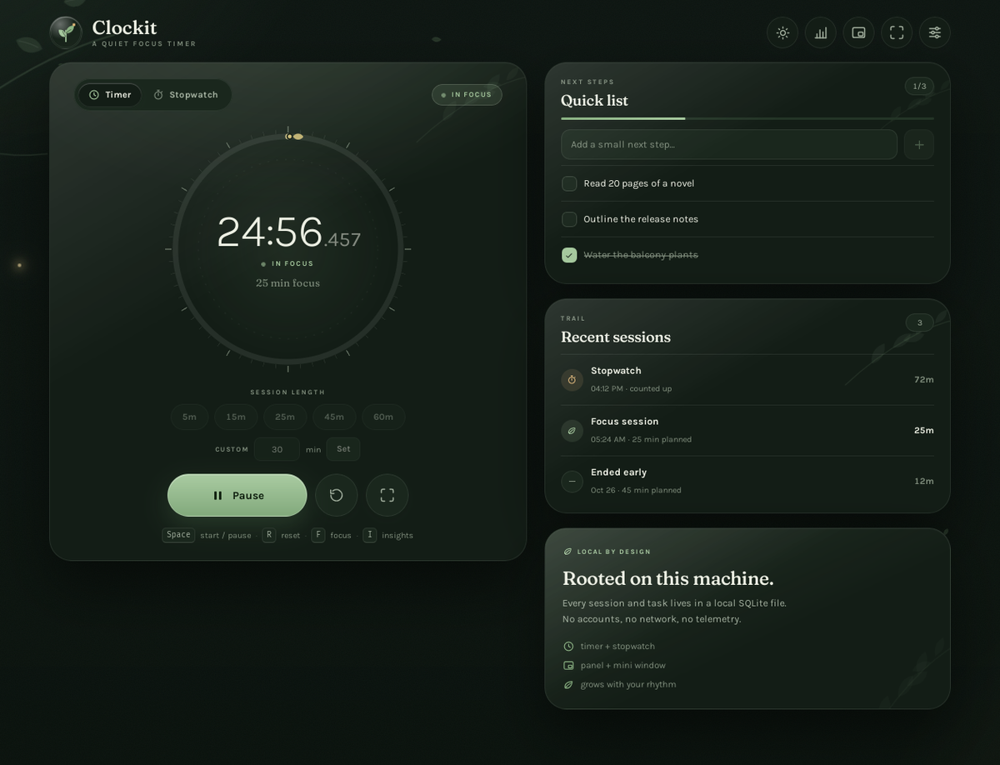

# Clockit

A calm, local-first focus timer and stopwatch for Pop!_OS and COSMIC. Clockit
keeps an authoritative wall-clock timer in Rust, lives in the COSMIC panel, and
stores everything on your machine: no accounts, no network calls, no telemetry.



## Features

- Countdown timer with 5 / 15 / 25 / 45 / 60 minute presets and a custom duration.
- Live milliseconds in the timer, stopwatch, mini window, and focus mode.
- Stopwatch that keeps its elapsed time across pauses and restarts.
- Start, pause, resume, and reset from the window, tray, panel applet, or CLI.
- Wall-clock engine: the timer survives app restarts and system suspend.
- Native COSMIC panel applet with the live countdown; one click starts, pauses,
  or resumes the timer straight from the panel.
- COSMIC panel tray with the live time and a start/pause, reset, mini window,
  and quit menu.
- Frameless mini window and a fullscreen focus mode with very large digits.
- Desktop notification and a soft chime when a countdown finishes.
- Quick checklist with add, rename, complete, and delete, stored locally.
- Session history for completed focus sessions, stopwatch runs, and sessions
  that ended early.
- Local app-usage insights on COSMIC: the active app, weekly and hourly charts,
  most-used apps, and recent activity, recorded through the
  `cosmic-toplevel-info` Wayland protocol.
- Idle- and lock-aware tracking: time away from the keyboard or behind a locked
  screen is trimmed instead of counted.
- Forest theme in daylight and night-wood palettes, with system, light, and dark
  modes, a theme switch, and reduced-motion support.
- Single instance with CLI flags, useful for COSMIC custom shortcuts.
- Local only: no cloud, no accounts, no analytics. Usage insight stores app IDs
  and durations only, never window titles, and rows are pruned after 90 days.

## Install

Download `Clockit_0.2.0_amd64.deb` from the
[latest release](https://github.com/Anos714/clockit/releases/latest) and install it:

```bash
sudo apt install ./Clockit_0.2.0_amd64.deb
```

The package installs two binaries, `clockit` and `clockit-applet`, plus the
desktop entries used by the app and the native COSMIC panel applet.

### Build from source

Build dependencies on Pop!_OS 24.04 / Ubuntu 24.04:

```bash
sudo apt install libwebkit2gtk-4.1-dev build-essential curl wget file \
  libxdo-dev libssl-dev libayatana-appindicator3-dev librsvg2-dev patchelf
```

Rust (stable) and Bun are also required.

```bash
git clone https://github.com/Anos714/clockit.git
cd clockit
bun install
bun run build:deb
sudo apt install ./src-tauri/target/release/bundle/deb/Clockit_0.2.0_amd64.deb
```

`build:deb` compiles the native panel applet first, then builds the Tauri app
and packs the app, the applet, and the applet desktop entry into one `.deb`.

## Using Clockit

### Timer and stopwatch

Pick a preset or type a custom length, then press Start. While a countdown is
running you can pause it, reset it, or switch to the stopwatch. The clock shows
seconds and a live millisecond fraction; the countdown ends with a notification
and a bundled chime.

### Focus mode and the mini window

Focus mode expands the clock to fill the window, with the controls kept close.
The mini window is a compact floating timer for keeping the clock on screen
while you work. On COSMIC, use window rules if the compositor ignores the
always-on-top or frameless hints.

### Checklist

The Quick list holds small next steps. Add, rename, tick off, and delete items;
everything is stored in the local database. The count in the corner shows what
is still open.

### Insights

Insights shows which app was active and for how long, with weekly and hourly
charts, most-used apps, and recent activity. Tracking uses COSMIC's
`cosmic-toplevel-info` protocol, drops idle and locked time, and stores only app
IDs and durations. On non-COSMIC sessions the view explains that window
information is unavailable while the timer keeps working.

### COSMIC panel and tray

The native applet appears in COSMIC panel settings after installation: open
**COSMIC Settings → Desktop → Panel → Add applet** and choose **Clockit**. The
applet shows the live countdown and toggles the timer with a click; when Clockit
is not running it shows a dash and launches the app on click.

The applet talks to the running app over the session D-Bus service
`com.clockit.Timer` at `/com/clockit/Timer`, which exposes `State`, `Toggle`,
`Start`, `Pause`, `Reset`, and `Show`. The service is local to your session and
does not open a network port.

Tauri also provides an AppIndicator/StatusNotifierItem tray. COSMIC shows it as
a menu (a Linux appindicator limitation), so the native applet is the one-click
panel control.

## CLI

Clockit is a single instance: a second invocation forwards the command to the
running app and exits. That makes these flags usable from COSMIC custom
shortcuts without Wayland global-hotkey support.

| Command | Action |
| --- | --- |
| `clockit --toggle` | Start, pause, or resume |
| `clockit --start 1500` | Start a 25-minute countdown |
| `clockit --start` | Start with the default duration |
| `clockit --stopwatch` | Switch to stopwatch mode |
| `clockit --countdown` | Switch back to countdown mode |
| `clockit --stopwatch --start` | Start counting up immediately |
| `clockit --pause` | Pause |
| `clockit --resume` | Resume |
| `clockit --reset` | Reset the current run |
| `clockit --show` | Open and focus the main window |
| `clockit --mini` | Open the mini window |
| `clockit --hidden` | Start in the tray without opening the window |
| `clockit --quit` | Quit Clockit |

Mode switches are applied before `--start`. Suggested COSMIC shortcuts:
`clockit --toggle` and `clockit --reset`.

## Keyboard shortcuts

| Key | Action |
| --- | --- |
| `Space` | Start or pause |
| `R` | Reset |
| `F` | Toggle focus mode |
| `I` | Open insights |
| `Esc` | Close the current panel or leave focus mode |

## Data and privacy

Everything lives in `~/.local/share/clockit/clockit.db` (SQLite, WAL mode):
settings, the current timer snapshot, sessions, checklist items, and usage
segments. Clockit makes no network requests and has no account system.

Usage insights keep app IDs and durations only. Window titles are never stored.
Segments are split at local hour and day boundaries, and rows older than 90 days
are pruned automatically. Tracking, its idle threshold, and clearing the history
are all controlled from Settings. Autostart is opt-in.

## Architecture

```
src-tauri/src/
  lib.rs        app wiring, plugins, window lifecycle
  timer.rs      wall-clock countdown + stopwatch engine, tray labels, alerts
  timer_bus.rs  session D-Bus service used by the panel applet
  store.rs      SQLite: settings, timer snapshot, sessions, tasks, usage
  settings.rs   persisted preferences, including theme and privacy
  tray.rs       tray icon and menu
  cli.rs        CLI flags + single-instance forwarding
  commands.rs   Tauri commands used by the UI
  windows.rs    main/mini window helpers
  usage/
    mod.rs      usage service, status, snapshots, retention
    tracker.rs  COSMIC toplevel + idle + logind lock tracker
    protocol.rs generated cosmic-toplevel-info bindings
src-tauri/protocols/  vendored COSMIC protocol XML (permissive licence)
src/
  App.tsx       main window + focus mode UI
  MiniApp.tsx   mini window UI
  useTimer.ts   backend state + smooth local clock
  useTheme.ts   system / light / dark theme sync
  theme.ts      theme resolution and flash-free caching
  format.ts     clock, duration, and insights formatting
  usage.ts      friendly app-name display for app IDs
  styles.css    forest design system, motion, responsive rules
  components/   TimerRing, ModeSwitch, TodoList, SessionList,
                Insights, SettingsPanel, Botanical, Icons
public/fonts/   bundled Fraunces + Karla variable fonts (OFL)
applet/
  src/main.rs   native libcosmic panel applet and D-Bus client
  data/         applet desktop entry, installed by the .deb
```

The timer engine uses wall-clock timestamps rather than counting ticks, so the
remaining time stays correct through suspend, resume, and app restarts. The
frontend smooths the display between backend updates; Rust remains the source
of truth. The panel applet reads the same engine over D-Bus.

## Development

```bash
bun install
bun run tauri dev
```

The first Rust build downloads and compiles the Tauri stack, so it takes a few
minutes.

Run the test suites:

```bash
cargo test --manifest-path src-tauri/Cargo.toml
cargo test --manifest-path applet/Cargo.toml
```

The frontend is type-checked during `bun run build`.

## Troubleshooting

- **The applet is not in the panel list.** Install the `.deb`, then reopen
  COSMIC panel settings. The applet desktop entry is installed to
  `/usr/share/applications/com.clockit.Clockit.desktop`.
- **The tray opens a menu instead of toggling.** That is the Linux
  AppIndicator behavior on COSMIC; use the native applet for one-click control.
- **The mini window is tiled or not always on top.** COSMIC may ignore frameless
  and always-on-top hints, especially in a tiling layout. Use window rules or a
  floating workspace.
- **Insights says usage is unavailable.** Tracking needs a COSMIC Wayland
  session; the timer and the rest of the app still work elsewhere.
- **No sound at the end of a session.** Clockit plays its bundled WAV through
  `pw-play` or `paplay`; install one of those players.
- **Autostart does nothing in development.** Enabling autostart from `tauri dev`
  registers the debug binary, not the installed one.

## Roadmap

- Phase 1 (complete): local timer, stopwatch, checklist, sessions, forest UI.
- Phase 2 (complete): COSMIC app-usage tracking, idle/lock handling, Insights.
- Phase 3 (complete): native libcosmic panel applet over D-Bus with a one-click
  panel timer.
- Cross-device sync is intentionally deferred. Clockit stays local-only for now.

## License

Clockit is released under the [MIT License](LICENSE).

Bundled Fraunces and Karla fonts are used under the SIL Open Font License; their
license files are in `public/fonts/`. The vendored COSMIC protocol XML keeps its
original permissive license.

## Credits

- [Tauri](https://tauri.app/) and [libcosmic](https://github.com/pop-os/libcosmic)
- [COSMIC](https://system76.com/cosmic) desktop environment
- Fraunces and Karla typefaces (SIL OFL)
- All artwork is inline SVG and CSS; no images are fetched at runtime
